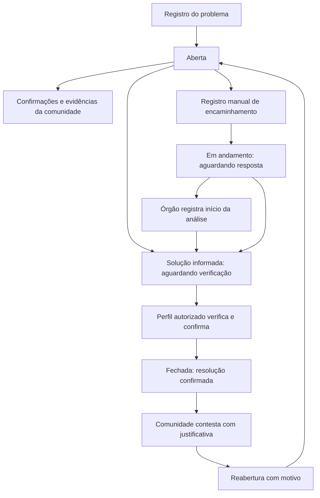

# Fluxo de ocorrências

O morador registra um problema com título, descrição, categoria, importância (baixa, média ou alta), cidade e endereço ou ponto de referência. Fotos e vídeos podem complementar o relato. A ocorrência começa **aberta**, e a comunidade pode confirmar que também observou o problema e adicionar evidências.

A comunidade pode sugerir órgãos do catálogo. Na página da ocorrência, somente seu autor vê a lista de sugestões, pesquisa por órgão ou pessoa que sugeriu e escolhe uma opção cadastrada. Após a janela de edição de 15 minutos, essa escolha é validada pelo servidor e encaminhada ao endereço institucional do órgão.

Ela passa para **em andamento** quando o encaminhamento por e-mail é confirmado pelo provedor, quando um encaminhamento manual é registrado pela moderação ou quando uma solução é informada para verificação. O órgão associado pode registrar o início da análise e descrever a ação realizada. O sistema diferencia encaminhamento registrado, análise iniciada e solução aguardando verificação; o registro de um encaminhamento não comprova que o órgão recebeu ou iniciou um serviço.

Informar uma solução não encerra o caso automaticamente. A moderação ou o órgão associado deve confirmar a resolução e explicar como ela foi verificada. Só então a ocorrência aparece como **fechada**. Se o problema persistir ou retornar, a comunidade pode contestar o fechamento e registrar o motivo da reabertura. Datas, responsáveis e justificativas ficam no histórico.

## Regras da implementação

- Confirmações comunitárias não mudam o estado nem aumentam automaticamente a importância.
- O cadastro informa critérios de importância e exige localização que permita encontrar o problema.
- A aceitação de uma sugestão associa o órgão cadastrado e inicia o envio do dossiê por e-mail. O status só muda após a confirmação do provedor; isso não comprova leitura pelo órgão. Contatos de destino não são expostos no catálogo do cliente.
- O protocolo é opcional; a ausência de protocolo não deve ser interpretada como recebimento confirmado.
- Uma solução informada continua em andamento até a verificação. Não existe fechamento automático por prazo.
- Moradores podem sugerir órgãos; somente o autor da ocorrência pode aceitar uma sugestão daquela ocorrência. O servidor valida o vínculo e o cadastro do órgão antes de encaminhar. A moderação mantém as ações administrativas e de verificação; o órgão associado pode registrar análise e verificar soluções.
- Os três estados visuais agrupam os estados detalhados já usados pela API. Registros antigos com importância crítica são exibidos como alta; novos registros oferecem baixa, média e alta.
- Esta versão fecha apenas como resolvida. Encerramento por duplicidade ou outros motivos exige um contrato específico com o backend e não foi acrescentado.

## Persistência e validação

Ocorrências com identificador da API continuam usando os endpoints existentes do servidor. Alterações só aparecem como concluídas depois da resposta; erros são mostrados na interface. O fluxo local mantém os dados e o histórico no navegador para demonstração e testes. Isso não substitui a persistência e a autorização do servidor para uso entre usuários.

Builds de produção do cliente e do backend e as suítes automatizadas foram concluídos: 57 testes do cliente e 121 do backend passaram. A cobertura inclui autorização, envio e interface. O envio real não foi executado nesta conferência e depende da configuração de e-mail e de órgãos ativos no catálogo do backend.

## Sugestões enquanto o catálogo está vazio

Sem órgãos cadastrados, moradores podem sugerir um nome real por texto. Exemplos são apenas orientação no formulário, sem registros fictícios. O autor vê uma seção permanente, com sugestões agrupadas pelo identificador do órgão ou pelo nome normalizado e ordenadas pelo número de participantes identificados distintos. Repetições da mesma pessoa não aumentam a contagem; registros sem identificador de autor não comprovam participantes distintos. Sugestões sem cadastro permanecem visíveis, mas não permitem encaminhamento. A escolha existente ainda encaminha pelo servidor e respeita sua janela de 15 minutos; separar associação de encaminhamento depende de um novo contrato no backend.

## Teste com órgãos fictícios

Em `/occurrences/mock-ana-1`, “Sugerir órgão responsável” oferece dois órgãos de exemplo no seletor, sem buscar a API. Na primeira abertura autenticada deste teste, a conta atual é definida como autora da cópia local. Não há painel de preparação nem sugestões pré-preenchidas. Sugestões enviadas ficam visíveis na lista e no histórico apenas para o autor na interface. A escolha associa o órgão localmente, sem envio real. Outra conta no mesmo navegador pode sugerir e não vê a lista do autor. Dados de mocks ficam no navegador; testes entre navegadores exigem persistência do servidor. A privacidade de ocorrências reais também precisa ser garantida no endpoint de histórico, não apenas na interface.
